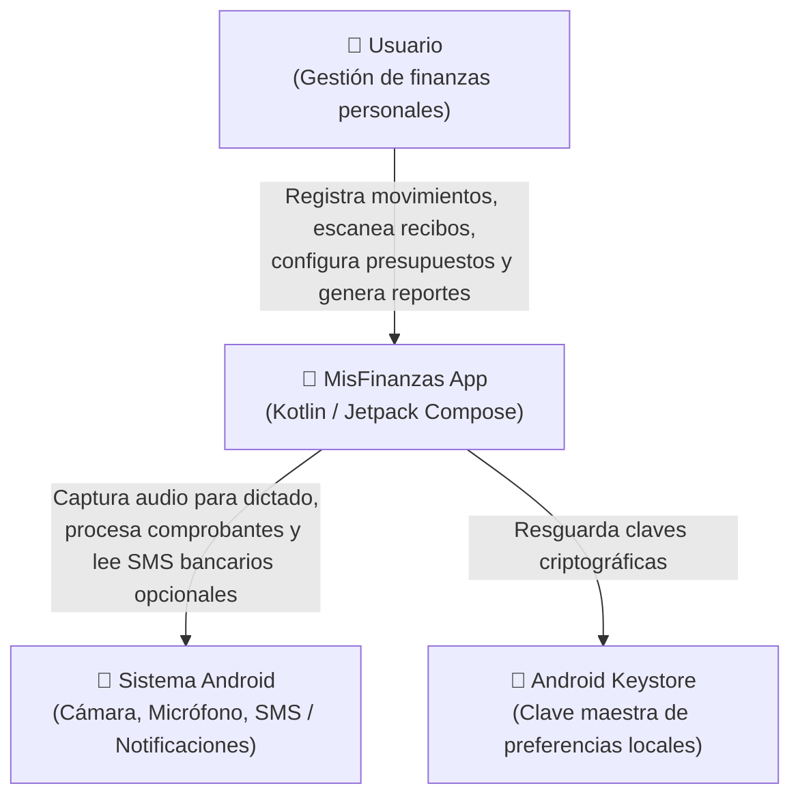
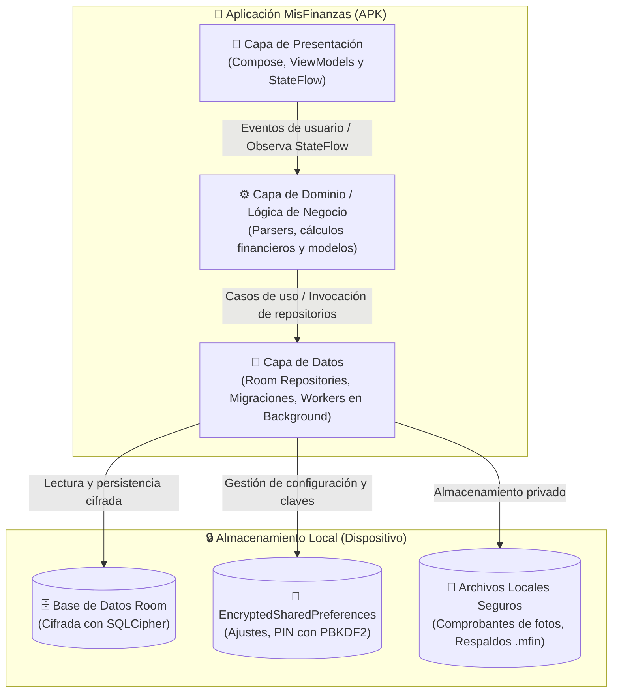
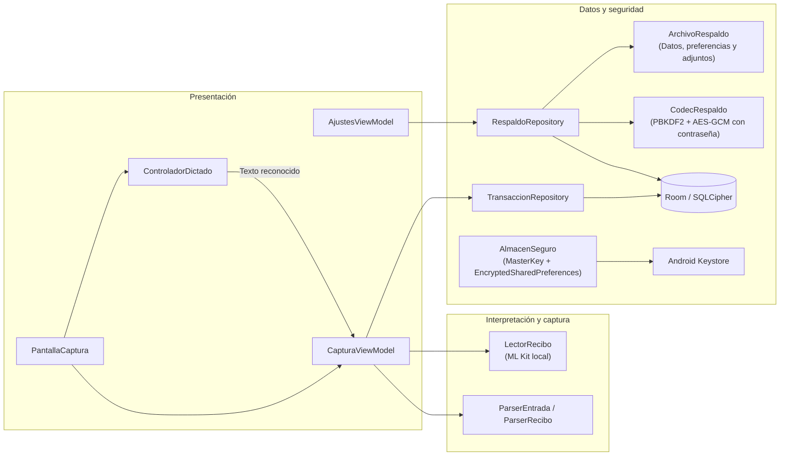

# Arquitectura de MisFinanzas

Este documento describe la arquitectura técnica de la aplicación móvil **MisFinanzas** utilizando el estándar **C4 Model** (Contexto, Contenedores y Componentes).

---

## 1. Nivel 1: Contexto de Sistema (System Context)

Muestra a qué usuarios sirve la aplicación y cómo interactúa con el ecosistema y hardware del dispositivo Android.

---

## 2. Nivel 2: Contenedor (Container Diagram)

Describe los subsistemas y capas que componen el artefacto de la aplicación y su almacenamiento local seguro (*Offline-First*).

---

## 3. Nivel 3: Componentes (Component Diagram)

Detalla la interacción entre los módulos de captura (Voz, OCR, Manual), lógica financiera y seguridad.

---

## Principios Clave de Diseño

1. **Privacidad y Cero Rastreo (Offline-First):**
   * La aplicación no requiere cuenta en la nube ni conexión a internet para su lógica central.
   * La base de datos SQLite está totalmente cifrada mediante **SQLCipher**.
2. **Entrada Asistida Multimodal:**
   * Soporta registro manual rápido, dictado por voz local en el dispositivo y escaneo óptico (OCR) de facturas y comprobantes.
   * El servicio de voz del teléfono es una alternativa elegida explícitamente por el usuario tras un aviso de posible procesamiento del audio en línea.
3. **Manejo Seguro de Identidad y Respaldo:**
   * Bloqueo por PIN con derivación de llave PBKDF2 y soporte biométrico.
   * Los respaldos portátiles `.mfin` se cifran con contraseña: `CodecRespaldo` deriva una llave con PBKDF2 y usa AES-GCM.
   * `AlmacenSeguro` protege las preferencias de seguridad y la passphrase local con `MasterKey` y `EncryptedSharedPreferences`. La disponibilidad de protección por hardware depende del dispositivo.
